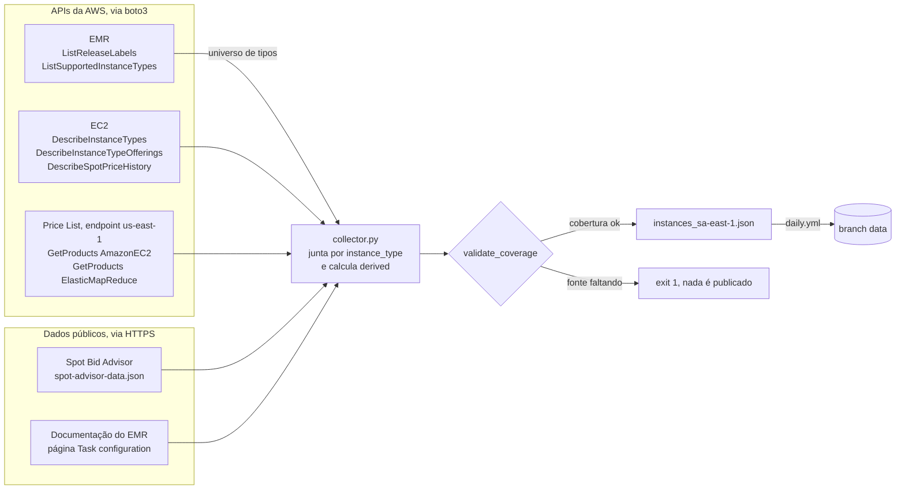

# aws-emr-instances-sa-east-1

Catálogo diário, em JSON, das instâncias que o Amazon EMR suporta em São Paulo (`sa-east-1`): hardware, preço on-demand e spot por AZ, taxa do EMR e memória do YARN.

[](https://github.com/marcelo-franceschini/aws-emr-instances-sa-east-1/actions/workflows/ci.yml)
[](https://github.com/marcelo-franceschini/aws-emr-instances-sa-east-1/actions/workflows/daily.yml)

Todo dia às 09:00 UTC, um workflow do GitHub Actions consulta seis ações de API da AWS e duas fontes públicas, cruza tudo por tipo de instância e publica um único arquivo, `instances_sa-east-1.json`, na branch [`data`](https://github.com/marcelo-franceschini/aws-emr-instances-sa-east-1/tree/data). Com ele dá para escolher a instância de um cluster EMR pelo custo real (EC2 mais a taxa do EMR) e pela memória que o YARN de fato entrega, filtrando com `jq` ou com um LLM.

## Sumário

- [Visão geral](#visão-geral)
- [Demonstração](#demonstração)
- [Arquitetura](#arquitetura)
- [Pré-requisitos](#pré-requisitos)
- [Início rápido](#início-rápido)
- [Uso](#uso)
- [Formato do JSON](#formato-do-json)
  - [Exemplo completo de uma instância](#exemplo-completo-de-uma-instância)
  - [Como ler os campos](#como-ler-os-campos)
  - [Campos derivados](#campos-derivados)
  - [Versões do schema](#versões-do-schema)
- [Configuração](#configuração)
- [Estrutura do repositório](#estrutura-do-repositório)
- [Desenvolvimento](#desenvolvimento)
- [Deploy e operação](#deploy-e-operação)
- [Decisões de design e limitações](#decisões-de-design-e-limitações)
- [Fora de escopo](#fora-de-escopo)
- [Licença e contato](#licença-e-contato)
- [JSON Schema](#json-schema)

## Visão geral

**O problema.** Escolher a instância de um cluster EMR exige cruzar fontes que não conversam: o hardware está no EC2, o preço on-demand na Price List, a taxa do EMR em outro serviço da Price List, o spot no histórico de preços de cada AZ, o risco de interrupção no Spot Bid Advisor e a memória que o YARN pode alocar só numa tabela da documentação do EMR. O preço do EC2 sozinho não responde "esta carga cabe nesta máquina e quanto ela custa de verdade?".

**A solução.** O comando `emr-collect` consulta essas fontes, une tudo por `instance_type` e grava um registro por tipo suportado pelo release mais recente do EMR na região (465 tipos no `emr-7.14.0`). Cada registro traz:

- hardware: vCPU, núcleos, memória, disco local, EBS e rede com banda sustentada e de pico, clock, GPU e as AZs que ofertam o tipo;
- preço: on-demand, taxa do EMR, spot vigente com estatísticas de 30 dias por AZ e faixa de interrupção;
- YARN: memória por nó e limites de contêiner que o EMR configura por padrão;
- campos derivados: razões e custo total por vCPU, por GB de YARN e por unidade de normalização.

**Para quem.** Para quem dimensiona clusters EMR em `sa-east-1` e quer filtrar candidatas por custo e capacidade sem montar essa junção à mão. O formato também foi pensado para um LLM que avalia cargas PySpark: os valores são numéricos, nenhuma chave some e o bloco `static` pode ser congelado como constante.

## Demonstração

Baixe o arquivo publicado e peça as três instâncias com menor custo total em spot por GB de YARN, entre as que têm pelo menos 4 GB de YARN por vCPU:

```bash
curl -fsSL https://raw.githubusercontent.com/marcelo-franceschini/aws-emr-instances-sa-east-1/data/instances_sa-east-1.json -o instances_sa-east-1.json

jq '[.instances[]
     | select(.derived.yarn_memory_gb_per_vcpu >= 4
              and .derived.total_spot_usd_per_yarn_gb_hour != null)
     | {instance_type,
        usd_per_yarn_gb_hour: .derived.total_spot_usd_per_yarn_gb_hour,
        az_id: .pricing.spot.az_id}]
    | sort_by(.usd_per_yarn_gb_hour) | .[:3]' instances_sa-east-1.json
```

Saída com a coleta de 29/10/2026, 11:21 UTC (os preços mudam a cada coleta):

```json
[
  {
    "instance_type": "r5ad.24xlarge",
    "usd_per_yarn_gb_hour": 0.001752,
    "az_id": "sae1-az1"
  },
  {
    "instance_type": "r5ad.16xlarge",
    "usd_per_yarn_gb_hour": 0.001917,
    "az_id": "sae1-az3"
  },
  {
    "instance_type": "r5.16xlarge",
    "usd_per_yarn_gb_hour": 0.001943,
    "az_id": "sae1-az1"
  }
]
```

## Arquitetura



- O EMR define o universo: as outras fontes entram por junção, e tipo que a região oferta mas o release não suporta fica de fora.
- Cada fonte tem um módulo em [`src/emr_instances/sources/`](src/emr_instances/sources/) e é lida numa varredura paginada da região inteira, sem uma chamada por tipo de instância.
- `validate_coverage` mede a falta de cada campo e aborta a coleta quando uma fonte essencial some (limites em [Configuração](#configuração)). Assim o workflow fica vermelho em vez de publicar nulos.

## Pré-requisitos

Para consumir o JSON publicado:

- `curl` e [`jq`](https://github.com/jqlang/jq).

Para gerar o JSON:

- Python 3.12 ou superior ([`.python-version`](.python-version) fixa 3.12) e [uv](https://docs.astral.sh/uv/).
- Credenciais AWS com as seis permissões de leitura da [política IAM mínima](#política-iam-mínima). A coleta não cria nem altera recursos.
- Acesso HTTPS a `spot-bid-advisor.s3.amazonaws.com` e `docs.aws.amazon.com`, que ficam fora da API da AWS.

## Início rápido

### Usar o JSON publicado

```bash
curl -fsSL https://raw.githubusercontent.com/marcelo-franceschini/aws-emr-instances-sa-east-1/data/instances_sa-east-1.json -o instances_sa-east-1.json
jq '{schema_version, release_label, generated_at, instance_count}' instances_sa-east-1.json
```

```json
{
  "schema_version": 3,
  "release_label": "emr-7.14.0",
  "generated_at": "2026-10-29T11:22:54.422032+00:00",
  "instance_count": 465
}
```

### Gerar o JSON na sua máquina

```bash
git clone https://github.com/marcelo-franceschini/aws-emr-instances-sa-east-1.git
cd aws-emr-instances-sa-east-1
uv sync
AWS_PROFILE=sa-east-1 uv run emr-collect
```

Troque `sa-east-1` pelo nome do seu perfil AWS (o passo a passo está em [Replicando em outra conta](#replicando-em-outra-conta)). A coleta leva de 1,5 a 4 minutos e grava `instances_sa-east-1.json` na raiz do repositório, arquivo que o `.gitignore` ignora.

## Uso

### Linha de comando

```text
uv run emr-collect [--release-label RELEASE_LABEL] [--output OUTPUT]
```

As opções estão em [Configuração](#configuração). O log sai em português na saída de erro, com a cobertura de cada campo no fim.

| Código de saída | Quando                                                                                                                      |
| --------------- | --------------------------------------------------------------------------------------------------------------------------- |
| `0`             | o JSON foi gravado                                                                                                          |
| `1`             | a coleta falhou: erro da API da AWS, cobertura abaixo do limite, página de YARN com formato desconhecido ou erro de escrita |
| `2`             | argumento inválido na linha de comando                                                                                      |

### Consultas com jq

Do básico ao avançado, todas sobre o schema 3.

Preço spot de um tipo:

```bash
jq '.instances[] | select(.instance_type == "r8gd.4xlarge") | .pricing.spot' instances_sa-east-1.json
```

```json
{
  "usd_hour": 0.7475,
  "az": "sa-east-1c",
  "az_id": "sae1-az3"
}
```

Graviton com NVMe local e interrupção abaixo de 10% (faixas 0 e 1). O `!= null` é necessário porque, no jq, `null <= 1` é verdadeiro:

```bash
jq '[.instances[]
     | select(.static.architecture == "arm64"
              and .static.storage.nvme == "required"
              and .pricing.spot_interruption.interruption_rate != null
              and .pricing.spot_interruption.interruption_rate <= 1)
     | .instance_type]' instances_sa-east-1.json
```

Os cinco tipos mais baratos em on-demand, custo total, com pelo menos 16 vCPUs e 100 GB de YARN:

```bash
jq '[.instances[]
     | select(.static.vcpu >= 16 and .derived.yarn_memory_gb >= 100
              and .derived.total_on_demand_usd_hour != null)
     | {instance_type, usd_hour: .derived.total_on_demand_usd_hour}]
    | sort_by(.usd_hour) | .[:5]' instances_sa-east-1.json
```

Spot de um tipo em cada AZ, pelo ID da AZ, para usar em outra conta (ver [Como ler os campos](#como-ler-os-campos)):

```bash
jq '[.instances[] | select(.instance_type == "r8gd.4xlarge")
     | .pricing.spot_by_az[] | {az_id, current_usd_hour, p95_usd_hour}]' instances_sa-east-1.json
```

```json
[
  {
    "az_id": "sae1-az1",
    "current_usd_hour": 1.077,
    "p95_usd_hour": 1.0927
  },
  {
    "az_id": "sae1-az2",
    "current_usd_hour": 0.8446,
    "p95_usd_hour": 0.97
  },
  {
    "az_id": "sae1-az3",
    "current_usd_hour": 0.7475,
    "p95_usd_hour": 0.9506
  }
]
```

## Formato do JSON

O arquivo é um objeto com o envelope e a lista `instances`:

- `region`: sempre `sa-east-1`;
- `release_label`: release do EMR usado na coleta (ex.: `emr-7.14.0`);
- `schema_version`: versão do formato (atual: `3`);
- `generated_at`: instante em que o arquivo foi montado, em ISO 8601 com fuso UTC;
- `instance_count`: número de registros;
- `instances`: um registro por tipo, em ordem alfabética de `instance_type`.

Cada registro tem `instance_type` no topo e quatro blocos: `static` nunca muda para um dado tipo, `pricing` muda a cada coleta e vem datado em `as_of`, `emr_yarn` depende do release do EMR e `derived` é calculado a partir dos outros três. Toda chave existe sempre: dado ausente vem como `null` e lista vazia como `[]`.

O [JSON Schema](#json-schema) no fim deste README descreve cada campo, com tipo, unidade e origem.

### Exemplo completo de uma instância

Registro real de `r8gd.4xlarge` na coleta de 29/10/2026, sem edição: extraído com `jq -c '.instances[] | select(.instance_type == "r8gd.4xlarge")'`, formatado com Prettier 3.3.3 e validado contra o [JSON Schema](#json-schema).

```json
{
  "instance_type": "r8gd.4xlarge",
  "static": {
    "vcpu": 16,
    "cores": 16,
    "threads_per_core": 1,
    "memory_gb_emr": 122.0,
    "memory_gb_hardware": 128.0,
    "architecture": "arm64",
    "processor_manufacturer": "AWS",
    "processor_name": "AWS Graviton4 Processor",
    "clock_ghz_sustained": 2.8,
    "family_category": "Memory optimized",
    "family_id_emr": "HI_MEM_CURRENT_GEN",
    "current_generation": true,
    "bare_metal": false,
    "hypervisor": "nitro",
    "burstable_performance": false,
    "normalization_factor": 32,
    "supports_spot": true,
    "availability_zones": ["sa-east-1a", "sa-east-1b", "sa-east-1c"],
    "availability_zone_ids": ["sae1-az1", "sae1-az2", "sae1-az3"],
    "storage": {
      "ebs_only": false,
      "total_gb": 950,
      "nvme": "required",
      "disks": [{ "count": 1, "size_gb": 950, "type": "ssd" }]
    },
    "ebs": {
      "baseline_mbps": 5000,
      "maximum_mbps": 10000,
      "baseline_iops": 20000,
      "maximum_iops": 40000,
      "burstable": true,
      "nvme": "required",
      "optimized_by_default": true
    },
    "network": {
      "baseline_gbps": 7.5,
      "peak_gbps": 15.0,
      "burstable": true,
      "max_interfaces": 8,
      "ena": "required",
      "efa": false
    },
    "gpu": null
  },
  "pricing": {
    "as_of": "2026-10-29T11:21:27.269435+00:00",
    "on_demand_usd_hour": 1.8616,
    "emr_fee_usd_hour": 0.29392,
    "spot": { "usd_hour": 0.7475, "az": "sa-east-1c", "az_id": "sae1-az3" },
    "spot_by_az": [
      {
        "az": "sa-east-1a",
        "az_id": "sae1-az1",
        "current_usd_hour": 1.077,
        "window_days": 30,
        "min_usd_hour": 0.9607,
        "mean_usd_hour": 1.027004,
        "median_usd_hour": 1.0266,
        "p95_usd_hour": 1.0927,
        "max_usd_hour": 1.1535,
        "stddev_usd_hour": 0.03244,
        "price_changes": 109
      },
      {
        "az": "sa-east-1b",
        "az_id": "sae1-az2",
        "current_usd_hour": 0.8446,
        "window_days": 30,
        "min_usd_hour": 0.71,
        "mean_usd_hour": 0.785605,
        "median_usd_hour": 0.7548,
        "p95_usd_hour": 0.97,
        "max_usd_hour": 1.0365,
        "stddev_usd_hour": 0.080196,
        "price_changes": 117
      },
      {
        "az": "sa-east-1c",
        "az_id": "sae1-az3",
        "current_usd_hour": 0.7475,
        "window_days": 30,
        "min_usd_hour": 0.6446,
        "mean_usd_hour": 0.731311,
        "median_usd_hour": 0.6789,
        "p95_usd_hour": 0.9506,
        "max_usd_hour": 1.0172,
        "stddev_usd_hour": 0.097664,
        "price_changes": 117
      }
    ],
    "spot_interruption": { "savings_percent": 46, "interruption_rate": 4 }
  },
  "emr_yarn": {
    "nodemanager_memory_mb": 116736,
    "scheduler_max_allocation_mb": 116736,
    "scheduler_min_allocation_mb": 1
  },
  "derived": {
    "memory_gb_per_vcpu": 8.0,
    "memory_gb_emr_per_vcpu": 7.625,
    "yarn_memory_gb": 114.0,
    "yarn_memory_gb_per_vcpu": 7.125,
    "yarn_memory_share_of_hardware": 0.891,
    "local_disk_gb_per_vcpu": 59.375,
    "ebs_baseline_mbps_per_vcpu": 312.5,
    "network_baseline_gbps_per_vcpu": 0.469,
    "total_on_demand_usd_hour": 2.15552,
    "total_spot_usd_hour": 1.04142,
    "total_spot_p95_usd_hour": 1.24452,
    "spot_discount_percent": 59.8,
    "spot_volatility_cv": 0.134,
    "total_spot_usd_per_vcpu_hour": 0.065089,
    "total_spot_usd_per_yarn_gb_hour": 0.009135,
    "total_spot_usd_per_normalization_unit_hour": 0.032544,
    "total_on_demand_usd_per_vcpu_hour": 0.13472,
    "total_on_demand_usd_per_yarn_gb_hour": 0.018908
  }
}
```

### Como ler os campos

Contagens da coleta de 29/10/2026 com o `emr-7.14.0`. Elas mudam com o release e com a AWS.

- **A memória aparece em três números diferentes.** `memory_gb_hardware` é o que a máquina tem. `memory_gb_emr` é o que o EMR informa, menor em 351 dos 465 tipos (mediana de 95,3% do hardware). `derived.yarn_memory_gb` é o que o YARN pode alocar por nó: entre 46,7% e 99% do hardware nos tipos que a documentação lista. Para dimensionar executores Spark, o número que vale é o do YARN.
- **Sustentado não é pico.** Em `ebs` e `network`, `baseline_*` é a banda sustentada e `maximum_*` ou `peak_*` é o pico com crédito de burst. 159 tipos fazem burst de EBS e 224 de rede. O caso extremo é `c7i-flex.xlarge`, que vai de 625 a 10000 Mbps de EBS, 16 vezes. Num job longo, quando o crédito acaba, vale o baseline. `burstable` traz a comparação pronta.
- **Spot: o mais barato agora e a distribuição.** `pricing.spot` é o menor preço vigente entre as AZs. No empate (82 dos 465 tipos nesta coleta), fica a AZ de menor P95, a mais estável, e depois a de menor nome. `spot_by_az` traz cada AZ com 30 dias de histórico, com estatísticas ponderadas pelo tempo em que cada preço vigorou, porque a AWS não grava o preço em intervalos regulares. `price_changes` conta só as trocas de valor: a AWS repete o preço vigente em registros sucessivos, umas quatro vezes por dia.
- **Interrupção vai de 0 a 4.** `interruption_rate` é a faixa do Spot Bid Advisor: 0 = <5%, 1 = 5-10%, 2 = 10-15%, 3 = 15-20% e 4 = >20%. Nesta coleta, 306 dos 465 tipos estão na faixa 4. `savings_percent` é a economia sobre o on-demand que o Advisor publica; `derived.spot_discount_percent` é outra conta, feita com o preço vigente na coleta.
- **A taxa do EMR não é proporcional ao EC2.** `emr_fee_usd_hour` é cobrada por instância-hora além do EC2. De `m5.8xlarge` a `m5.24xlarge`, por exemplo, ela é a mesma, 0,27 USD/hora. O custo real é EC2 mais a taxa, já somado nos campos `derived.total_*`.
- **Nome de AZ vale só numa conta.** A AWS sorteia por conta qual AZ física recebe cada nome, então `sa-east-1c` aqui pode ser outra AZ na sua conta. `az_id` e `availability_zone_ids` (`sae1-az1`, `sae1-az2`, `sae1-az3`) são iguais em toda conta. Para ver o par nome e ID na sua conta (exige `ec2:DescribeAvailabilityZones`, permissão que a coleta não usa):

  ```bash
  aws ec2 describe-availability-zones --region sa-east-1 --query 'AvailabilityZones[].[ZoneName, ZoneId]' --output text
  ```

- **YARN é o padrão da documentação.** `emr_yarn` vem da coluna `Default value` da página Task configuration, que segue o release mais recente do EMR. É `null` em 16 tipos que a página ainda não lista (famílias `r8i` e `r8i-flex`). Um cluster que altera `yarn-site` ou usa `maximizeResourceAllocation` tem outros valores.
- **Nenhuma chave some.** `storage` existe mesmo nos 250 tipos EBS-only (com `ebs_only: true` e `disks: []`), e `gpu` é `null` nos 439 tipos sem GPU. Quem consome nunca precisa testar se a chave existe.
- **Universo e precedência.** O universo é o que `ListSupportedInstanceTypes` devolve para o release: tipo ofertado na região que o release não suporta (como `m6in`, `m6idn` e `r7gd` no `emr-7.14.0`) não entra. Quando duas fontes têm o mesmo dado, o hardware vem do EC2, que é numérico (a Price List descreve disco em 93 formatos de texto); o nome comercial do processador e a categoria de família vêm da Price List; e o suporte do EMR vem do EMR.

### Campos derivados

O bloco `derived` não traz dado novo: é razão ou soma de campos dos outros blocos, calculada na coleta para que quem consome filtre e ordene sem refazer a conta. Uma entrada ausente deixa `null` só os campos que dependem dela.

| Campo                                                          | Cálculo                                                 |
| -------------------------------------------------------------- | ------------------------------------------------------- |
| `memory_gb_per_vcpu`, `memory_gb_emr_per_vcpu`                 | memória do hardware (ou do EMR) / vCPU                  |
| `yarn_memory_gb`, `yarn_memory_gb_per_vcpu`                    | `nodemanager_memory_mb` / 1024 (e / vCPU)               |
| `yarn_memory_share_of_hardware`                                | memória do YARN / memória do hardware                   |
| `local_disk_gb_per_vcpu`                                       | disco local / vCPU (`0` em tipo EBS-only)               |
| `ebs_baseline_mbps_per_vcpu`, `network_baseline_gbps_per_vcpu` | banda sustentada / vCPU                                 |
| `total_on_demand_usd_hour`                                     | EC2 on-demand + taxa do EMR                             |
| `total_spot_usd_hour`, `total_spot_p95_usd_hour`               | spot vigente (ou P95 da AZ do spot) + taxa do EMR       |
| `spot_discount_percent`                                        | desconto do spot sobre o on-demand, só na parte do EC2  |
| `spot_volatility_cv`                                           | desvio / média do spot na AZ do spot                    |
| `total_*_usd_per_vcpu_hour`, `total_*_usd_per_yarn_gb_hour`    | custo total / vCPU (ou GB de YARN), em spot e on-demand |
| `total_spot_usd_per_normalization_unit_hour`                   | custo total em spot / fator de normalização             |

Os custos `total_*` ficam `null` quando falta a taxa do EMR, em vez de sair só com o EC2: um total sem a taxa pareceria barato e distorceria o ranking. No spot, a taxa somada é a de on-demand, na premissa de que o EMR não a desconta; confira na fatura.

### Versões do schema

| Versão | Formato                                                                                                                                 |
| ------ | --------------------------------------------------------------------------------------------------------------------------------------- |
| 1      | registro plano de 9 campos, sem `schema_version`                                                                                        |
| 2      | blocos `static` e `pricing`, com o catálogo completo de hardware                                                                        |
| 3      | acrescenta `pricing.emr_fee_usd_hour`, `pricing.spot_by_az`, `emr_yarn`, `derived` e o ID de cada AZ (`az_id`, `availability_zone_ids`) |

`instance_type` fica no topo do registro em todas as versões. Confira `schema_version` antes de consumir o arquivo.

## Configuração

| Parâmetro                                    | Padrão                                | Descrição                                                         |
| -------------------------------------------- | ------------------------------------- | ----------------------------------------------------------------- |
| `--release-label`                            | release mais recente em `sa-east-1`   | release do EMR que define o universo de tipos (ex.: `emr-7.13.0`) |
| `--output`                                   | `instances_sa-east-1.json`            | caminho do JSON gerado                                            |
| `AWS_PROFILE`                                | cadeia de credenciais padrão do boto3 | perfil de credenciais AWS                                         |
| `AWS_ACCESS_KEY_ID`, `AWS_SECRET_ACCESS_KEY` | cadeia de credenciais padrão do boto3 | credenciais diretas; é o que o workflow diário usa                |

A região não vem do ambiente: os clients usam `sa-east-1` e, para a Price List, `us-east-1`, fixos no código. A região configurada no perfil AWS é ignorada.

Constantes em [`config.py`](src/emr_instances/config.py) e [`aws.py`](src/emr_instances/aws.py), alteradas no código:

| Constante                       | Valor                       | Descrição                                                               |
| ------------------------------- | --------------------------- | ----------------------------------------------------------------------- |
| `REGION`                        | `sa-east-1`                 | região coletada                                                         |
| `PRICING_ENDPOINT_REGION`       | `us-east-1`                 | endpoint da Price List API                                              |
| `SPOT_HISTORY_DAYS`             | `30`                        | janela do histórico spot usada nas estatísticas por AZ                  |
| `MAX_MISSING_PRICE_RATIO`       | `0.05`                      | fração máxima de tipos sem preço on-demand, spot ou taxa do EMR         |
| `MAX_MISSING_CATALOG_RATIO`     | `0.05`                      | fração máxima sem hardware, oferta por AZ, ID de AZ ou detalhe de disco |
| `MAX_MISSING_PUBLIC_DATA_RATIO` | `0.25`                      | fração máxima sem padrões de YARN ou sem faixa de interrupção           |
| retry dos clients boto3         | 5 tentativas, modo adaptive | definido em `build_clients`                                             |

## Estrutura do repositório

```text
.
├── .github/workflows/
│   ├── ci.yml              lint, formatação, mypy e pytest em push na master e em PR
│   └── daily.yml           coleta diária e publicação na branch data
├── src/emr_instances/
│   ├── cli/collect.py      entrypoint do emr-collect; único lugar que vira código de saída
│   ├── collector.py        junta as fontes, valida a cobertura e monta o payload
│   ├── derived.py          bloco derived: razões e custo por unidade
│   ├── models.py           TypedDicts do JSON e SCHEMA_VERSION
│   ├── config.py           região, arquivo de saída, janela spot e limites de cobertura
│   ├── aws.py              clients boto3 com retry adaptativo
│   ├── storage.py          gravação do JSON
│   ├── errors.py           exceções de domínio (CoverageError, StorageError, SourceFormatError)
│   └── sources/            uma fonte externa por módulo
│       ├── emr.py          ListReleaseLabels e ListSupportedInstanceTypes
│       ├── ec2.py          DescribeInstanceTypes e DescribeInstanceTypeOfferings
│       ├── pricing.py      Price List: preço do EC2, campos de catálogo e taxa do EMR
│       ├── spot.py         DescribeSpotPriceHistory por AZ e Spot Bid Advisor
│       └── yarn.py         padrões de YARN lidos da documentação do EMR
├── tests/                  espelha src/emr_instances
├── pyproject.toml          dependências, console script e configuração de ruff, mypy e pytest
└── uv.lock                 dependências travadas
```

O endpoint de cada serviço externo mora no módulo que fala com ele, e `config.py` guarda só o que é compartilhado. As camadas internas levantam as exceções de [`errors.py`](src/emr_instances/errors.py); só [`cli/collect.py`](src/emr_instances/cli/collect.py) as traduz em código de saída, o que mantém os módulos testáveis sem capturar `SystemExit`.

## Desenvolvimento

```bash
uv sync --dev                 # pytest, mypy, ruff e os stubs do boto3
uv run pytest                 # testes
uv run mypy .                 # tipos
uv run ruff check .           # lint
uv run ruff format --check .  # formatação
```

O [CI](.github/workflows/ci.yml) roda os mesmos quatro passos em todo push na `master` e em todo pull request, com as dependências travadas (`uv sync --frozen --dev`).

Os testes não chamam a AWS nem a internet: os clients do boto3 e o `requests.get` são substituídos por mocks. Uma coleta real é só leitura, mas leva minutos e depende das fontes externas; rode uma ao fim de cada mudança, não a cada teste.

Para contribuir, abra uma issue ou um pull request contra a `master`; o CI precisa passar. Comentários, docstrings e mensagens de log são em português, e os commits seguem `tipo: descrição` (`feat`, `fix`, `docs`, `refactor`, `test`, `chore`, `ci`).

### Conferindo este README

O exemplo e o JSON Schema deste README são verificados com ferramentas determinísticas. Para conferir a formatação do README inteiro, incluindo os blocos JSON:

```bash
npx --yes prettier@3.3.3 --check README.md
```

Para extrair o JSON Schema, passar o lint e validar uma coleta nova contra ele:

````bash
awk '/^## JSON Schema/{s=1} s && /^```json$/{f=1; next} f && /^```$/{exit} f' README.md > /tmp/instances.schema.json
npx --yes @sourcemeta/jsonschema@17.3.2 lint --exclude top_level_examples /tmp/instances.schema.json
npx --yes @sourcemeta/jsonschema@17.3.2 validate /tmp/instances.schema.json instances_sa-east-1.json
````

Ao mudar `models.py`, atualize o schema e o exemplo e repita as três verificações.

## Deploy e operação

### Política IAM mínima

A coleta precisa de seis ações, todas de leitura:

```json
{
  "Version": "2012-10-17",
  "Statement": [
    {
      "Sid": "EmrList",
      "Effect": "Allow",
      "Action": [
        "elasticmapreduce:ListSupportedInstanceTypes",
        "elasticmapreduce:ListReleaseLabels"
      ],
      "Resource": "*"
    },
    {
      "Sid": "Pricing",
      "Effect": "Allow",
      "Action": ["pricing:GetProducts", "ec2:DescribeSpotPriceHistory"],
      "Resource": "*"
    },
    {
      "Sid": "Ec2InstanceCatalog",
      "Effect": "Allow",
      "Action": [
        "ec2:DescribeInstanceTypes",
        "ec2:DescribeInstanceTypeOfferings"
      ],
      "Resource": "*"
    }
  ]
}
```

O ID de cada AZ vem do próprio histórico spot, então `ec2:DescribeAvailabilityZones` não é necessária.

### Replicando em outra conta

1. **Crie um usuário IAM dedicado**, sem acesso ao console (aqui: `aws-emr-instances-sa-east-1`), anexe a política acima como customer-managed e gere uma access key.
2. **Configure o perfil local** para rodar o `emr-collect` na sua máquina:

   ```bash
   aws configure --profile sa-east-1   # Access Key ID, Secret e região sa-east-1
   ```

3. **Cadastre dois secrets no GitHub**, em Settings, Secrets and variables, Actions: `AWS_ACCESS_KEY_ID` e `AWS_SECRET_ACCESS_KEY`.
4. **Dispare o workflow** em Actions, "EMR instances (sa-east-1)", Run workflow. A coleta roda pelo cron ou por esse disparo manual, nunca por `push`: um push na `master` aciona só o CI. Em repositório novo, o workflow só aparece na aba Actions depois do primeiro push do arquivo; se não aparecer, faça outro push e recarregue a página.
5. **Confirme** que a branch `data` existe e tem o arquivo `instances_sa-east-1.json`.

### Como o workflow diário se comporta

- Roda às 09:00 UTC (06:00 em São Paulo) e por `workflow_dispatch`, com `timeout-minutes: 20` e uma execução por vez.
- As ações ficam fixadas por SHA, e o token de escrita só chega ao passo de publicação (`persist-credentials: false` no checkout).
- Se o JSON não mudou, nada é commitado.
- A coleta falha, com código de saída 1, workflow vermelho e o e-mail de falha que o GitHub já manda, quando:
  - mais de 5% dos tipos ficam sem preço on-demand, spot ou taxa do EMR;
  - mais de 5% ficam sem hardware, oferta por AZ, ID de AZ ou detalhe de disco;
  - mais de 25% ficam sem padrões de YARN ou sem faixa de interrupção (dados públicos de fora das APIs, que atrasam em tipos novos);
  - a página de YARN muda de formato, mesmo em parte: primeira coluna de valor que não é a padrão, valor que não é número ou nenhuma tabela reconhecida.
- Quando a coleta falha, nada é publicado e a branch `data` continua com o último JSON bom. Não há outra notificação além do e-mail do GitHub.

## Decisões de design e limitações

- **Blocos por volatilidade.** `static` não muda, `pricing` muda a cada coleta, `emr_yarn` muda com o release e `derived` é recalculado. Quem consome pode congelar `static` e atualizar só o resto.
- **`null` em vez de omitir ou estimar.** Dado ausente vira `null`, e a chave nunca some. Custo total sem a taxa do EMR também vira `null`, para não distorcer o ranking.
- **Falhar alto.** Fonte essencial ausente derruba a coleta. Um aviso só no log não teria leitor.
- **Taxa do EMR no spot.** É tratada como a de on-demand. A documentação pública da AWS não confirma nem nega, e a Price List do EMR só tem termo OnDemand.
- **Fontes públicas sem contrato.** O Spot Bid Advisor e a página de YARN não são APIs: podem mudar de formato ou atrasar em tipos novos (hoje, a família `r8i`). O parser de YARN levanta `SourceFormatError` em vez de publicar valores de outra coluna.
- **`az_id` depende do histórico spot.** Ele vem do `AvailabilityZoneId` de `DescribeSpotPriceHistory`. Se a AWS deixar de devolvê-lo, a checagem de ID de AZ derruba a coleta em vez de publicar sem ID.
- **Uma foto por dia.** O arquivo traz o estado da coleta; não há série histórica além da janela de 30 dias do spot. A branch `data` guarda as versões anteriores no histórico do git.
- **Escopo fixo.** Só `sa-east-1`, só Linux (on-demand e spot Linux/UNIX) e um release do EMR por arquivo.

## Fora de escopo

- **Medições do seu job.** Duração, custo por execução e variância de cada candidata no seu benchmark pertencem a um arquivo à parte (por exemplo, `measurements.json`), unido a este por `instance_type`. O catálogo descreve a máquina; as medições dizem como ela se comporta na sua carga.
- **Outros dados possíveis, ainda não coletados:** taxas de Savings Plans, preço de referência de EBS e de transferência entre AZs, e as cotas de vCPU da sua conta.

## Licença e contato

Ainda não há arquivo de licença no repositório.

<!-- TODO: escolher a licença, adicionar o arquivo LICENSE e citá-la aqui. -->

Mantido por [@marcelo-franceschini](https://github.com/marcelo-franceschini). Dúvidas, erros nos dados e sugestões: [issues](https://github.com/marcelo-franceschini/aws-emr-instances-sa-east-1/issues).

## JSON Schema

Schema do arquivo inteiro, em JSON Schema 2020-12:

- tipos, nulidade, campos obrigatórios e ordem dos campos vêm dos `TypedDict` de [`models.py`](src/emr_instances/models.py), gerados com `pydantic.TypeAdapter(Payload).json_schema()`;
- as descrições foram escritas a partir do código de [`sources/`](src/emr_instances/sources/), [`collector.py`](src/emr_instances/collector.py) e [`derived.py`](src/emr_instances/derived.py), os valores enumerados vêm dos tipos `Literal` dos stubs do boto3, e a faixa de `interruption_rate`, da tabela `ranges` do Spot Advisor;
- `additionalProperties: false` em todo objeto, então uma chave nova ou faltando falha na validação;
- formatado com Prettier 3.3.3, aprovado no `lint` do [Sourcemeta JSON Schema CLI](https://github.com/sourcemeta/jsonschema) 17.3.2 (exceto a regra `top_level_examples`, porque o exemplo completo está em [Exemplo completo de uma instância](#exemplo-completo-de-uma-instância)) e validado contra a coleta inteira de 29/10/2026.

```json
{
  "$schema": "https://json-schema.org/draft/2020-12/schema",
  "title": "instances_sa-east-1.json",
  "type": "object",
  "description": "Catálogo das instâncias suportadas pelo Amazon EMR em sa-east-1, gerado pelo `emr-collect`. Todas as chaves de todos os objetos estão sempre presentes: dado ausente vem como `null` e lista vazia vem como `[]`",
  "properties": {
    "region": { "const": "sa-east-1", "description": "Região AWS coletada" },
    "release_label": {
      "type": "string",
      "description": "Release do EMR que define o universo de tipos: o mais recente da região, ou o passado em `--release-label`. Ex.: `emr-7.14.0`"
    },
    "schema_version": {
      "const": 3,
      "description": "Versão do formato deste arquivo"
    },
    "generated_at": {
      "type": "string",
      "format": "date-time",
      "description": "Instante em que o arquivo foi montado, em ISO 8601 com fuso UTC. Fica depois do `as_of` dos registros, que marca o início da coleta"
    },
    "instance_count": {
      "type": "integer",
      "description": "Número de registros em `instances`"
    },
    "instances": {
      "type": "array",
      "items": { "$ref": "#/$defs/InstanceRecord" },
      "description": "Um registro por tipo suportado pelo release, em ordem alfabética de `instance_type`"
    }
  },
  "required": [
    "region",
    "release_label",
    "schema_version",
    "generated_at",
    "instance_count",
    "instances"
  ],
  "additionalProperties": false,
  "$defs": {
    "InstanceRecord": {
      "type": "object",
      "description": "Um tipo de instância. `static` não muda para o tipo, `pricing` muda a cada coleta, `emr_yarn` depende do release do EMR e `derived` é calculado a partir dos outros três",
      "properties": {
        "instance_type": {
          "type": "string",
          "description": "Tipo de instância, como o EMR o lista (`ListSupportedInstanceTypes`). Chave do registro. Ex.: `r8gd.4xlarge`"
        },
        "static": {
          "$ref": "#/$defs/StaticSpec",
          "description": "Hardware e catálogo"
        },
        "pricing": {
          "$ref": "#/$defs/PricingSpec",
          "description": "Preços da coleta"
        },
        "emr_yarn": {
          "anyOf": [{ "$ref": "#/$defs/YarnDefaults" }, { "type": "null" }],
          "description": "Padrões de YARN, ou `null` quando a página Task configuration não lista o tipo"
        },
        "derived": {
          "$ref": "#/$defs/DerivedSpec",
          "description": "Razões e custos calculados"
        }
      },
      "required": ["instance_type", "static", "pricing", "emr_yarn", "derived"],
      "additionalProperties": false
    },
    "StaticSpec": {
      "type": "object",
      "description": "Hardware e catálogo do tipo, juntando EMR, EC2 e Price List. Não muda para um dado tipo e pode ser tratado como constante",
      "properties": {
        "vcpu": {
          "type": ["integer", "null"],
          "description": "vCPUs padrão (`VCpuInfo.DefaultVCpus`)"
        },
        "cores": {
          "type": ["integer", "null"],
          "description": "Núcleos físicos padrão (`VCpuInfo.DefaultCores`)"
        },
        "threads_per_core": {
          "type": ["integer", "null"],
          "description": "Threads por núcleo (`VCpuInfo.DefaultThreadsPerCore`)"
        },
        "memory_gb_emr": {
          "type": ["number", "null"],
          "description": "Memória que o EMR informa para o tipo (`MemoryGB` de `ListSupportedInstanceTypes`), com 2 casas. Costuma ser menor que `memory_gb_hardware`. Não é a memória do YARN"
        },
        "memory_gb_hardware": {
          "type": ["number", "null"],
          "description": "Memória física em GiB (`MemoryInfo.SizeInMiB` / 1024, com 2 casas)"
        },
        "architecture": {
          "enum": ["arm64", "arm64_mac", "i386", "x86_64", "x86_64_mac", null],
          "description": "Arquitetura escolhida de `ProcessorInfo.SupportedArchitectures`, com prioridade para `arm64`, depois `x86_64` e `i386`"
        },
        "processor_manufacturer": {
          "type": ["string", "null"],
          "description": "Fabricante do processador segundo o EC2 (`ProcessorInfo.Manufacturer`). Ex.: `AWS`, `Intel`, `AMD`"
        },
        "processor_name": {
          "type": ["string", "null"],
          "description": "Nome comercial do processador, da Price List (`physicalProcessor`). Ex.: `AWS Graviton4 Processor`"
        },
        "clock_ghz_sustained": {
          "type": ["number", "null"],
          "description": "Clock sustentado em GHz (`ProcessorInfo.SustainedClockSpeedInGhz`). A AWS não publica para alguns tipos"
        },
        "family_category": {
          "type": ["string", "null"],
          "description": "Categoria da família na Price List (`instanceFamily`). Ex.: `Memory optimized`"
        },
        "family_id_emr": {
          "type": ["string", "null"],
          "description": "Família segundo o EMR (`InstanceFamilyId`). Ex.: `HI_MEM_CURRENT_GEN`"
        },
        "current_generation": {
          "type": ["boolean", "null"],
          "description": "Se o EC2 marca o tipo como geração atual (`CurrentGeneration`)"
        },
        "bare_metal": {
          "type": ["boolean", "null"],
          "description": "Se o tipo é bare metal (`BareMetal`)"
        },
        "hypervisor": {
          "enum": ["nitro", "xen", null],
          "description": "Hypervisor do tipo (`Hypervisor`)"
        },
        "burstable_performance": {
          "type": ["boolean", "null"],
          "description": "Se o tipo usa créditos de CPU (`BurstablePerformanceSupported`)"
        },
        "normalization_factor": {
          "type": ["number", "null"],
          "description": "Fator de normalização de tamanho, da Price List (`normalizationSizeFactor`). Sai como inteiro quando o valor é exato"
        },
        "supports_spot": {
          "type": ["boolean", "null"],
          "description": "Se `SupportedUsageClasses` do EC2 inclui `spot`"
        },
        "availability_zones": {
          "type": "array",
          "items": { "type": "string" },
          "description": "Nomes das AZs que ofertam o tipo (`DescribeInstanceTypeOfferings`), em ordem alfabética. O nome só vale para a conta que coletou"
        },
        "availability_zone_ids": {
          "type": "array",
          "items": { "type": "string" },
          "description": "IDs das mesmas AZs, iguais em qualquer conta (ex.: `sae1-az1`), em ordem de ID. Não é alinhada posição a posição com `availability_zones`"
        },
        "storage": {
          "$ref": "#/$defs/StorageSpec",
          "description": "Disco local"
        },
        "ebs": {
          "$ref": "#/$defs/EbsSpec",
          "description": "Banda e IOPS de EBS"
        },
        "network": { "$ref": "#/$defs/NetworkSpec", "description": "Rede" },
        "gpu": {
          "anyOf": [{ "$ref": "#/$defs/GpuSpec" }, { "type": "null" }],
          "description": "GPU, ou `null` em tipo sem GPU"
        }
      },
      "required": [
        "vcpu",
        "cores",
        "threads_per_core",
        "memory_gb_emr",
        "memory_gb_hardware",
        "architecture",
        "processor_manufacturer",
        "processor_name",
        "clock_ghz_sustained",
        "family_category",
        "family_id_emr",
        "current_generation",
        "bare_metal",
        "hypervisor",
        "burstable_performance",
        "normalization_factor",
        "supports_spot",
        "availability_zones",
        "availability_zone_ids",
        "storage",
        "ebs",
        "network",
        "gpu"
      ],
      "additionalProperties": false
    },
    "StorageSpec": {
      "type": "object",
      "description": "Disco local (instance store), de `InstanceStorageInfo` do EC2. Em tipo EBS-only, `ebs_only` é `true`, `total_gb` e `nvme` são `null` e `disks` é vazia",
      "properties": {
        "ebs_only": {
          "type": ["boolean", "null"],
          "description": "`true` quando o tipo não tem disco local (`InstanceStorageSupported` falso)"
        },
        "total_gb": {
          "type": ["integer", "null"],
          "description": "Capacidade total de disco local em GB (`TotalSizeInGB`)"
        },
        "nvme": {
          "enum": ["required", "supported", "unsupported", null],
          "description": "Suporte a NVMe no disco local (`NvmeSupport`)"
        },
        "disks": {
          "type": "array",
          "items": { "$ref": "#/$defs/DiskSpec" },
          "description": "Grupos de discos locais"
        }
      },
      "required": ["ebs_only", "total_gb", "nvme", "disks"],
      "additionalProperties": false
    },
    "DiskSpec": {
      "type": "object",
      "description": "Um grupo de discos locais iguais",
      "properties": {
        "count": {
          "type": ["integer", "null"],
          "description": "Quantidade de discos do grupo"
        },
        "size_gb": {
          "type": ["integer", "null"],
          "description": "Tamanho de cada disco, em GB"
        },
        "type": {
          "enum": ["hdd", "ssd", null],
          "description": "Mídia do disco"
        }
      },
      "required": ["count", "size_gb", "type"],
      "additionalProperties": false
    },
    "EbsSpec": {
      "type": "object",
      "description": "EBS do tipo. Banda e IOPS vêm de `EbsInfo.EbsOptimizedInfo` do EC2; `optimized_by_default` vem do EMR",
      "properties": {
        "baseline_mbps": {
          "type": ["integer", "null"],
          "description": "Banda de EBS sustentada, em Mbps"
        },
        "maximum_mbps": {
          "type": ["integer", "null"],
          "description": "Banda de EBS de pico, em Mbps"
        },
        "baseline_iops": {
          "type": ["integer", "null"],
          "description": "IOPS de EBS sustentado"
        },
        "maximum_iops": {
          "type": ["integer", "null"],
          "description": "IOPS de EBS de pico"
        },
        "burstable": {
          "type": ["boolean", "null"],
          "description": "`maximum_mbps > baseline_mbps`; `null` se faltar um dos dois"
        },
        "nvme": {
          "enum": ["required", "supported", "unsupported", null],
          "description": "Suporte a NVMe nos volumes EBS (`EbsInfo.NvmeSupport`)"
        },
        "optimized_by_default": {
          "type": ["boolean", "null"],
          "description": "Se o EMR sobe o tipo com EBS otimizado por padrão (`EbsOptimizedByDefault` de `ListSupportedInstanceTypes`)"
        }
      },
      "required": [
        "baseline_mbps",
        "maximum_mbps",
        "baseline_iops",
        "maximum_iops",
        "burstable",
        "nvme",
        "optimized_by_default"
      ],
      "additionalProperties": false
    },
    "NetworkSpec": {
      "type": "object",
      "description": "Rede, de `NetworkInfo` do EC2. Banda da placa indicada por `DefaultNetworkCardIndex`",
      "properties": {
        "baseline_gbps": {
          "type": ["number", "null"],
          "description": "Banda sustentada da placa padrão, em Gbps (`BaselineBandwidthInGbps`)"
        },
        "peak_gbps": {
          "type": ["number", "null"],
          "description": "Banda de pico da placa padrão, em Gbps (`PeakBandwidthInGbps`)"
        },
        "burstable": {
          "type": ["boolean", "null"],
          "description": "`peak_gbps > baseline_gbps`; `null` se faltar um dos dois"
        },
        "max_interfaces": {
          "type": ["integer", "null"],
          "description": "Máximo de interfaces de rede (`MaximumNetworkInterfaces`)"
        },
        "ena": {
          "enum": ["required", "supported", "unsupported", null],
          "description": "Suporte a ENA (`EnaSupport`)"
        },
        "efa": {
          "type": ["boolean", "null"],
          "description": "Se suporta EFA (`EfaSupported`)"
        }
      },
      "required": [
        "baseline_gbps",
        "peak_gbps",
        "burstable",
        "max_interfaces",
        "ena",
        "efa"
      ],
      "additionalProperties": false
    },
    "GpuSpec": {
      "type": "object",
      "description": "Primeiro modelo de GPU de `GpuInfo` do EC2. Nenhum tipo suportado pelo EMR mistura modelos",
      "properties": {
        "name": {
          "type": ["string", "null"],
          "description": "Modelo da GPU. Ex.: `T4`"
        },
        "manufacturer": {
          "type": ["string", "null"],
          "description": "Fabricante da GPU. Ex.: `NVIDIA`"
        },
        "count": {
          "type": ["integer", "null"],
          "description": "Quantidade de GPUs do modelo"
        },
        "memory_total_gb": {
          "type": ["number", "null"],
          "description": "Memória total de GPU da instância, em GiB (`TotalGpuMemoryInMiB` / 1024, com 2 casas)"
        }
      },
      "required": ["name", "manufacturer", "count", "memory_total_gb"],
      "additionalProperties": false
    },
    "PricingSpec": {
      "type": "object",
      "description": "Preços da coleta, em USD por hora, para Linux. Muda a cada coleta",
      "properties": {
        "as_of": {
          "type": "string",
          "format": "date-time",
          "description": "Início da coleta, em ISO 8601 com fuso UTC. É o fim da janela do histórico spot"
        },
        "on_demand_usd_hour": {
          "type": ["number", "null"],
          "description": "Preço on-demand do EC2, da Price List (Linux, tenancy compartilhada, sem software pré-instalado)"
        },
        "emr_fee_usd_hour": {
          "type": ["number", "null"],
          "description": "Taxa do EMR por instância-hora, cobrada além do EC2 (Price List, serviço ElasticMapReduce, `softwareType` EMR). `null` quando a Price List não traz um preço único para o tipo"
        },
        "spot": {
          "anyOf": [{ "$ref": "#/$defs/SpotInfo" }, { "type": "null" }],
          "description": "Menor preço spot vigente entre as AZs. No empate, fica a AZ de menor `p95_usd_hour` e depois a de menor nome. `null` sem histórico spot"
        },
        "spot_by_az": {
          "type": "array",
          "items": { "$ref": "#/$defs/SpotAzStats" },
          "description": "Spot por AZ, em ordem alfabética de AZ"
        },
        "spot_interruption": {
          "anyOf": [{ "$ref": "#/$defs/SpotInterruption" }, { "type": "null" }],
          "description": "Dados do Spot Bid Advisor, ou `null` se o tipo não aparece lá"
        }
      },
      "required": [
        "as_of",
        "on_demand_usd_hour",
        "emr_fee_usd_hour",
        "spot",
        "spot_by_az",
        "spot_interruption"
      ],
      "additionalProperties": false
    },
    "SpotInfo": {
      "type": "object",
      "description": "Spot mais barato agora entre as AZs. É uma projeção de `spot_by_az`",
      "properties": {
        "usd_hour": {
          "type": "number",
          "description": "Preço spot vigente, em USD/hora"
        },
        "az": {
          "type": "string",
          "description": "Nome da AZ, válido só na conta que coletou"
        },
        "az_id": {
          "type": ["string", "null"],
          "description": "ID da AZ, igual em qualquer conta (ex.: `sae1-az3`). Use este campo para achar a AZ em outra conta"
        }
      },
      "required": ["usd_hour", "az", "az_id"],
      "additionalProperties": false
    },
    "SpotAzStats": {
      "type": "object",
      "description": "Preço spot de uma AZ na janela de `window_days` dias (`DescribeSpotPriceHistory`, Linux/UNIX). As estatísticas são ponderadas pelo tempo em que cada preço vigorou; o trecho da janela anterior ao primeiro registro fica de fora",
      "properties": {
        "az": {
          "type": "string",
          "description": "Nome da AZ, válido só na conta que coletou"
        },
        "az_id": {
          "type": ["string", "null"],
          "description": "ID da AZ, igual em qualquer conta"
        },
        "current_usd_hour": {
          "type": "number",
          "description": "Preço vigente (último registro da janela), em USD/hora"
        },
        "window_days": {
          "type": "integer",
          "description": "Tamanho da janela, em dias"
        },
        "min_usd_hour": {
          "type": "number",
          "description": "Menor preço na janela"
        },
        "mean_usd_hour": {
          "type": "number",
          "description": "Média ponderada pelo tempo"
        },
        "median_usd_hour": {
          "type": "number",
          "description": "Mediana ponderada pelo tempo"
        },
        "p95_usd_hour": {
          "type": "number",
          "description": "Percentil 95 ponderado pelo tempo: o preço só fica acima dele em 5% da janela"
        },
        "max_usd_hour": {
          "type": "number",
          "description": "Maior preço na janela"
        },
        "stddev_usd_hour": {
          "type": "number",
          "description": "Desvio padrão ponderado pelo tempo"
        },
        "price_changes": {
          "type": "integer",
          "description": "Quantas vezes o preço mudou de valor na janela. Registros que repetem o preço anterior não contam"
        }
      },
      "required": [
        "az",
        "az_id",
        "current_usd_hour",
        "window_days",
        "min_usd_hour",
        "mean_usd_hour",
        "median_usd_hour",
        "p95_usd_hour",
        "max_usd_hour",
        "stddev_usd_hour",
        "price_changes"
      ],
      "additionalProperties": false
    },
    "SpotInterruption": {
      "type": "object",
      "description": "Dados do Spot Bid Advisor (`spot-advisor-data.json`, S3 público) para Linux em sa-east-1",
      "properties": {
        "savings_percent": {
          "type": ["integer", "null"],
          "description": "Economia do spot sobre o on-demand segundo o Spot Advisor, em % (campo `s`)"
        },
        "interruption_rate": {
          "type": ["integer", "null"],
          "minimum": 0,
          "maximum": 4,
          "description": "Faixa de frequência de interrupção (campo `r`): 0 = <5%, 1 = 5-10%, 2 = 10-15%, 3 = 15-20%, 4 = >20%"
        }
      },
      "required": ["savings_percent", "interruption_rate"],
      "additionalProperties": false
    },
    "YarnDefaults": {
      "type": "object",
      "description": "Padrões de YARN do EMR para o tipo, lidos da coluna `Default value` da página Task configuration da documentação (release mais recente). Um cluster que altera `yarn-site` ou usa `maximizeResourceAllocation` tem outros valores",
      "properties": {
        "nodemanager_memory_mb": {
          "type": "integer",
          "description": "`yarn.nodemanager.resource.memory-mb`: memória que o YARN pode alocar no nó, em MB"
        },
        "scheduler_max_allocation_mb": {
          "type": ["integer", "null"],
          "description": "`yarn.scheduler.maximum-allocation-mb`: maior contêiner, em MB"
        },
        "scheduler_min_allocation_mb": {
          "type": ["integer", "null"],
          "description": "`yarn.scheduler.minimum-allocation-mb`: menor contêiner, em MB"
        }
      },
      "required": [
        "nodemanager_memory_mb",
        "scheduler_max_allocation_mb",
        "scheduler_min_allocation_mb"
      ],
      "additionalProperties": false
    },
    "DerivedSpec": {
      "type": "object",
      "description": "Razões e custos calculados na coleta a partir de `static`, `pricing` e `emr_yarn`. Cada campo é `null` quando falta uma das entradas. Os custos `total_*` somam a taxa do EMR ao EC2; no spot, a taxa somada é a mesma do on-demand",
      "properties": {
        "memory_gb_per_vcpu": {
          "type": ["number", "null"],
          "description": "`memory_gb_hardware / vcpu`, com 3 casas"
        },
        "memory_gb_emr_per_vcpu": {
          "type": ["number", "null"],
          "description": "`memory_gb_emr / vcpu`, com 3 casas"
        },
        "yarn_memory_gb": {
          "type": ["number", "null"],
          "description": "`nodemanager_memory_mb / 1024`, com 3 casas"
        },
        "yarn_memory_gb_per_vcpu": {
          "type": ["number", "null"],
          "description": "`yarn_memory_gb / vcpu`, com 3 casas"
        },
        "yarn_memory_share_of_hardware": {
          "type": ["number", "null"],
          "description": "`yarn_memory_gb / memory_gb_hardware`, com 3 casas"
        },
        "local_disk_gb_per_vcpu": {
          "type": ["number", "null"],
          "description": "`storage.total_gb / vcpu`, com 3 casas; `0` em tipo EBS-only"
        },
        "ebs_baseline_mbps_per_vcpu": {
          "type": ["number", "null"],
          "description": "`ebs.baseline_mbps / vcpu`, com 3 casas"
        },
        "network_baseline_gbps_per_vcpu": {
          "type": ["number", "null"],
          "description": "`network.baseline_gbps / vcpu`, com 3 casas"
        },
        "total_on_demand_usd_hour": {
          "type": ["number", "null"],
          "description": "`on_demand_usd_hour + emr_fee_usd_hour`"
        },
        "total_spot_usd_hour": {
          "type": ["number", "null"],
          "description": "`spot.usd_hour + emr_fee_usd_hour`"
        },
        "total_spot_p95_usd_hour": {
          "type": ["number", "null"],
          "description": "`p95_usd_hour` da AZ de `spot`, mais `emr_fee_usd_hour`"
        },
        "spot_discount_percent": {
          "type": ["number", "null"],
          "description": "`(1 - spot.usd_hour / on_demand_usd_hour) * 100`, com 1 casa. Só a parte do EC2, sem a taxa do EMR"
        },
        "spot_volatility_cv": {
          "type": ["number", "null"],
          "description": "`stddev_usd_hour / mean_usd_hour` da AZ de `spot`, com 3 casas (coeficiente de variação)"
        },
        "total_spot_usd_per_vcpu_hour": {
          "type": ["number", "null"],
          "description": "`total_spot_usd_hour / vcpu`"
        },
        "total_spot_usd_per_yarn_gb_hour": {
          "type": ["number", "null"],
          "description": "`total_spot_usd_hour / yarn_memory_gb`"
        },
        "total_spot_usd_per_normalization_unit_hour": {
          "type": ["number", "null"],
          "description": "`total_spot_usd_hour / normalization_factor`"
        },
        "total_on_demand_usd_per_vcpu_hour": {
          "type": ["number", "null"],
          "description": "`total_on_demand_usd_hour / vcpu`"
        },
        "total_on_demand_usd_per_yarn_gb_hour": {
          "type": ["number", "null"],
          "description": "`total_on_demand_usd_hour / yarn_memory_gb`"
        }
      },
      "required": [
        "memory_gb_per_vcpu",
        "memory_gb_emr_per_vcpu",
        "yarn_memory_gb",
        "yarn_memory_gb_per_vcpu",
        "yarn_memory_share_of_hardware",
        "local_disk_gb_per_vcpu",
        "ebs_baseline_mbps_per_vcpu",
        "network_baseline_gbps_per_vcpu",
        "total_on_demand_usd_hour",
        "total_spot_usd_hour",
        "total_spot_p95_usd_hour",
        "spot_discount_percent",
        "spot_volatility_cv",
        "total_spot_usd_per_vcpu_hour",
        "total_spot_usd_per_yarn_gb_hour",
        "total_spot_usd_per_normalization_unit_hour",
        "total_on_demand_usd_per_vcpu_hour",
        "total_on_demand_usd_per_yarn_gb_hour"
      ],
      "additionalProperties": false
    }
  }
}
```
