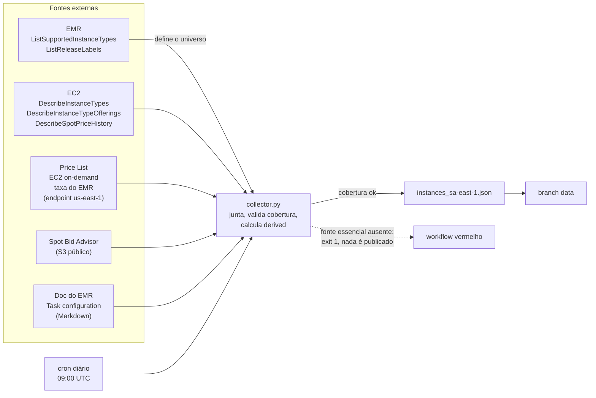

# aws-emr-instances-sa-east-1

Catálogo diário, em JSON, das instâncias suportadas pelo Amazon EMR em São Paulo (`sa-east-1`): hardware, preço e dados de YARN em um só lugar.

[](https://github.com/marcelo-franceschini/aws-emr-instances-sa-east-1/actions/workflows/ci.yml)

## Sumário

- [Visão geral](#visão-geral)
- [Demonstração](#demonstração)
- [Arquitetura](#arquitetura)
- [Pré-requisitos](#pré-requisitos)
- [Início rápido](#início-rápido)
- [Uso](#uso)
- [Configuração](#configuração)
- [Formato do JSON](#formato-do-json)
- [Estrutura do repositório](#estrutura-do-repositório)
- [Desenvolvimento](#desenvolvimento)
- [Deploy e operação](#deploy-e-operação)
- [Decisões de design e limitações](#decisões-de-design-e-limitações)
- [Fora de escopo](#fora-de-escopo)
- [Licença e contato](#licença-e-contato)

## Visão geral

**Problema.** Escolher a instância de um cluster EMR exige cruzar fontes que não conversam entre si: o hardware vem do EC2, o preço da Price List, a taxa do EMR de outro serviço da Price List, o spot do histórico de preços por AZ, a taxa de interrupção do Spot Advisor e a memória realmente alocável pelo YARN da documentação do EMR. "Quanto custa o EC2" não responde "esta carga cabe nesta máquina e quanto ela custa de verdade".

**Solução.** O comando `emr-collect` consulta essas fontes e grava um único arquivo, `instances_sa-east-1.json`, com uma entrada por tipo de instância suportado pelo release mais recente do EMR em `sa-east-1` (465 tipos no `emr-7.14.0`). Cada entrada traz:

- hardware completo (vCPU, cores, memória, disco, EBS e rede com baseline e pico, clock, GPU, AZs);
- preço on-demand, taxa do EMR e spot por AZ com estatísticas de 30 dias;
- taxa de interrupção spot;
- memória alocável pelo YARN;
- campos derivados (razões e custo por unidade) prontos para filtrar com `jq`.

**Para quem.** Para quem precisa filtrar e ranquear instâncias EMR por custo e capacidade, seja uma pessoa com `jq` ou um LLM que avalia cargas PySpark. O desenho do JSON (blocos `static`, `pricing`, `emr_yarn` e `derived`) assume esse segundo consumidor: o bloco `static` nunca muda para um dado tipo e pode ser congelado como constante.

O workflow [`daily.yml`](.github/workflows/daily.yml) roda a coleta todo dia e publica o JSON na branch órfã `data`. O arquivo não fica na branch de código.

## Demonstração

Com o JSON gerado, as três instâncias mais baratas por GB de YARN em spot (custo total, EC2 mais taxa do EMR), com pelo menos 4 GB de YARN por vCPU:

```bash
jq -c '[.instances[]
        | select(.derived.yarn_memory_gb_per_vcpu >= 4
                 and .derived.total_spot_usd_per_yarn_gb_hour != null)
        | {t: .instance_type, usd_gb: .derived.total_spot_usd_per_yarn_gb_hour}]
       | sort_by(.usd_gb) | .[:3]' instances_sa-east-1.json
```

Saída na coleta de 29/10/2026 (`emr-7.14.0`), que muda com os preços do dia:

```json
[{"t":"r5ad.24xlarge","usd_gb":0.001752},{"t":"r5ad.16xlarge","usd_gb":0.001917},{"t":"r5.16xlarge","usd_gb":0.001943}]
```

Para ver o formato completo de um registro, vá a [Formato do JSON](#formato-do-json).

## Arquitetura



Cada fonte tem um módulo em [`src/emr_instances/sources/`](src/emr_instances/sources/). O `collector.py` usa o EMR como universo, une as demais fontes por tipo de instância e valida a cobertura antes de gravar.

## Pré-requisitos

- Python 3.12 ou superior (o repositório fixa 3.12 em [`.python-version`](.python-version)).
- [uv](https://docs.astral.sh/uv/) para instalar as dependências.
- Credenciais AWS com as 6 permissões de leitura listadas em [Deploy e operação](#deploy-e-operação). A coleta só lê dados e não cria recursos.
- Acesso de rede ao Spot Advisor (S3 público) e à documentação do EMR, que não passam pela API da AWS.

## Início rápido

```bash
git clone git@github.com:marcelo-franceschini/aws-emr-instances-sa-east-1.git
cd aws-emr-instances-sa-east-1
uv sync
export AWS_PROFILE=sa-east-1   # perfil com a policy de leitura
uv run emr-collect             # leva de 1,5 a 4 minutos
```

O resultado é `instances_sa-east-1.json` na raiz. O arquivo está no `.gitignore`.

## Uso

```bash
uv run emr-collect --help
uv run emr-collect                                   # release mais recente, saída padrão
uv run emr-collect --release-label emr-7.13.0        # fixa o release
uv run emr-collect --output /tmp/instancias.json     # outro caminho de saída
```

O processo termina com código 0 quando grava o arquivo e com 1 em qualquer falha (chamada AWS que falha, cobertura insuficiente, erro de escrita). Os motivos aparecem no log, em português.

### Consultando com jq

O arquivo tem cerca de 1,9 MB, grande demais para caber inteiro numa janela de contexto, então a consulta é por filtro:

```bash
# Graviton com NVMe local e baixa interrupção (faixa 1 ou 2); o != null é
# necessário porque em jq null <= 2 é verdadeiro
jq '[.instances[]
     | select(.static.architecture == "arm64"
              and .static.storage.nvme == "required"
              and .pricing.spot_interruption.interruption_rate != null
              and .pricing.spot_interruption.interruption_rate <= 2)
     | .instance_type]' instances_sa-east-1.json

# um tipo específico, só o bloco de preço
jq '.instances[] | select(.instance_type == "r8gd.4xlarge") | .pricing' instances_sa-east-1.json
```

### Baixando o JSON publicado

A cada execução bem-sucedida do workflow diário, o arquivo é commitado na branch `data`:

```bash
curl -fsSL https://raw.githubusercontent.com/marcelo-franceschini/aws-emr-instances-sa-east-1/data/instances_sa-east-1.json -o instances_sa-east-1.json
```

<!-- TODO: a branch data ainda tem o formato anterior ao schema 3. Este comando entrega o schema 3 depois do merge da PR #1 e do primeiro cron. -->

## Configuração

O `emr-collect` não lê variáveis próprias. Os parâmetros são as opções da linha de comando e as variáveis padrão do boto3.

| Item | Padrão | Descrição |
| --- | --- | --- |
| `--release-label` | release mais recente em `sa-east-1` | Release do EMR que define o universo de instâncias e os padrões de YARN (ex.: `emr-7.13.0`) |
| `--output` | `instances_sa-east-1.json` | Caminho do JSON de saída |
| `AWS_PROFILE` | nenhum | Perfil de credenciais AWS (padrão do boto3) |
| `AWS_ACCESS_KEY_ID`, `AWS_SECRET_ACCESS_KEY` | nenhum | Credenciais diretas (padrão do boto3); é o que o workflow usa |

Constantes em [`config.py`](src/emr_instances/config.py), alteradas no código:

| Constante | Valor | Descrição |
| --- | --- | --- |
| `REGION` | `sa-east-1` | Região coletada |
| `PRICING_ENDPOINT_REGION` | `us-east-1` | A Price List API só existe neste endpoint |
| `SPOT_HISTORY_DAYS` | `30` | Janela do histórico spot usada nas estatísticas por AZ |
| `MAX_MISSING_PRICE_RATIO` | `0.05` | Fração máxima de tipos sem preço on-demand, spot ou taxa do EMR |
| `MAX_MISSING_CATALOG_RATIO` | `0.05` | Fração máxima sem hardware, oferta por AZ, ID de AZ ou detalhe de disco |
| `MAX_MISSING_PUBLIC_DATA_RATIO` | `0.25` | Fração máxima sem padrões de YARN ou sem taxa de interrupção |

## Formato do JSON

No envelope:

- `region`, `generated_at`, `instance_count`
- `release_label`: release usado na coleta, o mais recente disponível em `sa-east-1` (ex.: `"emr-7.14.0"`)
- `schema_version`: versão do formato (atual: `3`)
- `instances`: a lista de registros

Cada instância tem `instance_type` no topo e quatro blocos: `static` nunca muda para um dado tipo de instância (pode ser congelado, versionado e usado como constante), `pricing` muda todo dia e vem datado, `emr_yarn` depende do release do EMR e `derived` é calculado a partir dos outros três.

### Exemplo

Um registro real da coleta de 29/10/2026, extraído e formatado com `jq`
(`jq '.instances[] | select(.instance_type == "r8gd.4xlarge")' instances_sa-east-1.json`), sem edição à mão.

<details>
<summary>Registro de <code>r8gd.4xlarge</code></summary>

```json
{
  "instance_type": "r8gd.4xlarge",
  "static": {
    "vcpu": 16,
    "cores": 16,
    "threads_per_core": 1,
    "memory_gb_emr": 122.0,
    "memory_gb_hardware": 128.0,
    "architecture": "arm64",
    "processor_manufacturer": "AWS",
    "processor_name": "AWS Graviton4 Processor",
    "clock_ghz_sustained": 2.8,
    "family_category": "Memory optimized",
    "family_id_emr": "HI_MEM_CURRENT_GEN",
    "current_generation": true,
    "bare_metal": false,
    "hypervisor": "nitro",
    "burstable_performance": false,
    "normalization_factor": 32,
    "supports_spot": true,
    "availability_zones": [
      "sa-east-1a",
      "sa-east-1b",
      "sa-east-1c"
    ],
    "storage": {
      "ebs_only": false,
      "total_gb": 950,
      "nvme": "required",
      "disks": [
        {
          "count": 1,
          "size_gb": 950,
          "type": "ssd"
        }
      ]
    },
    "ebs": {
      "baseline_mbps": 5000,
      "maximum_mbps": 10000,
      "baseline_iops": 20000,
      "maximum_iops": 40000,
      "burstable": true,
      "nvme": "required",
      "optimized_by_default": true
    },
    "network": {
      "baseline_gbps": 7.5,
      "peak_gbps": 15.0,
      "burstable": true,
      "max_interfaces": 8,
      "ena": "required",
      "efa": false
    },
    "gpu": null
  },
  "pricing": {
    "as_of": "2026-10-29T09:59:35.377722+00:00",
    "on_demand_usd_hour": 1.8616,
    "emr_fee_usd_hour": 0.29392,
    "spot": {
      "usd_hour": 0.7475,
      "az": "sa-east-1c"
    },
    "spot_by_az": [
      {
        "az": "sa-east-1a",
        "current_usd_hour": 1.077,
        "window_days": 30,
        "min_usd_hour": 0.9607,
        "mean_usd_hour": 1.027151,
        "median_usd_hour": 1.0266,
        "p95_usd_hour": 1.0927,
        "max_usd_hour": 1.1535,
        "stddev_usd_hour": 0.032838,
        "price_changes": 122
      },
      {
        "az": "sa-east-1b",
        "current_usd_hour": 0.8446,
        "window_days": 30,
        "min_usd_hour": 0.71,
        "mean_usd_hour": 0.785974,
        "median_usd_hour": 0.7548,
        "p95_usd_hour": 0.97,
        "max_usd_hour": 1.0365,
        "stddev_usd_hour": 0.080906,
        "price_changes": 128
      },
      {
        "az": "sa-east-1c",
        "current_usd_hour": 0.7475,
        "window_days": 30,
        "min_usd_hour": 0.6446,
        "mean_usd_hour": 0.731831,
        "median_usd_hour": 0.6789,
        "p95_usd_hour": 0.9506,
        "max_usd_hour": 1.0172,
        "stddev_usd_hour": 0.098463,
        "price_changes": 125
      }
    ],
    "spot_interruption": {
      "savings_percent": 46,
      "interruption_rate": 4
    }
  },
  "emr_yarn": {
    "nodemanager_memory_mb": 116736,
    "scheduler_max_allocation_mb": 116736,
    "scheduler_min_allocation_mb": 1
  },
  "derived": {
    "memory_gb_per_vcpu": 8.0,
    "memory_gb_emr_per_vcpu": 7.625,
    "yarn_memory_gb": 114.0,
    "yarn_memory_gb_per_vcpu": 7.125,
    "yarn_memory_share_of_hardware": 0.891,
    "local_disk_gb_per_vcpu": 59.375,
    "ebs_baseline_mbps_per_vcpu": 312.5,
    "network_baseline_gbps_per_vcpu": 0.469,
    "total_on_demand_usd_hour": 2.15552,
    "total_spot_usd_hour": 1.04142,
    "total_spot_p95_usd_hour": 1.24452,
    "spot_discount_percent": 59.8,
    "spot_volatility_cv": 0.135,
    "total_spot_usd_per_vcpu_hour": 0.065089,
    "total_spot_usd_per_yarn_gb_hour": 0.009135,
    "total_spot_usd_per_normalization_unit_hour": 0.032544,
    "total_on_demand_usd_per_vcpu_hour": 0.13472,
    "total_on_demand_usd_per_yarn_gb_hour": 0.018908
  }
}
```

</details>

### Schema

As tabelas abaixo foram geradas a partir dos `TypedDict` de [`models.py`](src/emr_instances/models.py) com `pydantic.TypeAdapter(Payload).json_schema()`, e as descrições são as docstrings do código. "ou null" indica campo que pode vir `null`; a chave existe sempre. Ao mudar `models.py`, regenere as tabelas.

<details>
<summary>Campos por bloco</summary>

<a id="instancerecord"></a>

##### `InstanceRecord`

| Campo | Tipo |
| --- | --- |
| `instance_type` | texto |
| `static` | [`StaticSpec`](#staticspec) |
| `pricing` | [`PricingSpec`](#pricingspec) |
| `emr_yarn` | [`YarnDefaults`](#yarndefaults) ou null |
| `derived` | [`DerivedSpec`](#derivedspec) |

<a id="staticspec"></a>

##### `StaticSpec`

Tudo que não muda para um dado tipo de instância. Junta as quatro fontes de catálogo (EMR, EC2, ofertas por AZ e Price List) e pode ser congelado e versionado, só o bloco `pricing` precisa ser datado. Os dois campos de memória são propositalmente distintos: `memory_gb_hardware` é o que a máquina tem e `memory_gb_emr` é o que o EMR enxerga (menor em 351 dos 465 tipos). Nenhum dos dois é a memória alocável pelo YARN, que tem um corte bem maior e fica no bloco `emr_yarn`, porque depende do release do EMR. `availability_zones` traz os nomes da conta que coletou, que a AWS sorteia por conta; `availability_zone_ids` é o mesmo conjunto pelo ID da AZ, igual em toda conta, e é por ele que se cruza o catálogo com outra conta.

| Campo | Tipo |
| --- | --- |
| `vcpu` | inteiro ou null |
| `cores` | inteiro ou null |
| `threads_per_core` | inteiro ou null |
| `memory_gb_emr` | número ou null |
| `memory_gb_hardware` | número ou null |
| `architecture` | texto ou null |
| `processor_manufacturer` | texto ou null |
| `processor_name` | texto ou null |
| `clock_ghz_sustained` | número ou null |
| `family_category` | texto ou null |
| `family_id_emr` | texto ou null |
| `current_generation` | booleano ou null |
| `bare_metal` | booleano ou null |
| `hypervisor` | texto ou null |
| `burstable_performance` | booleano ou null |
| `normalization_factor` | número ou null |
| `supports_spot` | booleano ou null |
| `availability_zones` | lista de texto |
| `availability_zone_ids` | lista de texto |
| `storage` | [`StorageSpec`](#storagespec) |
| `ebs` | [`EbsSpec`](#ebsspec) |
| `network` | [`NetworkSpec`](#networkspec) |
| `gpu` | [`GpuSpec`](#gpuspec) ou null |

<a id="storagespec"></a>

##### `StorageSpec`

| Campo | Tipo |
| --- | --- |
| `ebs_only` | booleano ou null |
| `total_gb` | inteiro ou null |
| `nvme` | texto ou null |
| `disks` | lista de [`DiskSpec`](#diskspec) |

<a id="diskspec"></a>

##### `DiskSpec`

| Campo | Tipo |
| --- | --- |
| `count` | inteiro ou null |
| `size_gb` | inteiro ou null |
| `type` | texto ou null |

<a id="ebsspec"></a>

##### `EbsSpec`

Bloco `ebs` completo: o hardware do EC2 mais o único campo que só o EMR tem.

| Campo | Tipo |
| --- | --- |
| `baseline_mbps` | inteiro ou null |
| `maximum_mbps` | inteiro ou null |
| `baseline_iops` | inteiro ou null |
| `maximum_iops` | inteiro ou null |
| `burstable` | booleano ou null |
| `nvme` | texto ou null |
| `optimized_by_default` | booleano ou null |

<a id="networkspec"></a>

##### `NetworkSpec`

| Campo | Tipo |
| --- | --- |
| `baseline_gbps` | número ou null |
| `peak_gbps` | número ou null |
| `burstable` | booleano ou null |
| `max_interfaces` | inteiro ou null |
| `ena` | texto ou null |
| `efa` | booleano ou null |

<a id="gpuspec"></a>

##### `GpuSpec`

| Campo | Tipo |
| --- | --- |
| `name` | texto ou null |
| `manufacturer` | texto ou null |
| `count` | inteiro ou null |
| `memory_total_gb` | número ou null |

<a id="pricingspec"></a>

##### `PricingSpec`

Tudo que muda de um dia para o outro, sempre datado. `emr_fee_usd_hour` é a taxa do EMR cobrada por instância-hora além do EC2. Ela varia por tipo e não é proporcional ao preço do EC2. `spot` é o menor preço vigente entre as AZs (no empate, a AZ de menor P95 e depois a de menor nome); `spot_by_az` traz cada AZ com a distribuição na janela.

| Campo | Tipo |
| --- | --- |
| `as_of` | texto |
| `on_demand_usd_hour` | número ou null |
| `emr_fee_usd_hour` | número ou null |
| `spot` | [`SpotInfo`](#spotinfo) ou null |
| `spot_by_az` | lista de [`SpotAzStats`](#spotazstats) |
| `spot_interruption` | [`SpotInterruption`](#spotinterruption) ou null |

<a id="spotinfo"></a>

##### `SpotInfo`

Menor preço spot vigente e a AZ onde ele está. `az` é o nome da AZ na conta que coletou, e a AWS sorteia por conta qual AZ física recebe cada nome; `az_id` identifica a mesma AZ em qualquer conta.

| Campo | Tipo |
| --- | --- |
| `usd_hour` | número |
| `az` | texto |
| `az_id` | texto ou null |

<a id="spotazstats"></a>

##### `SpotAzStats`

Preço spot de uma AZ: o vigente agora e a distribuição na janela. As estatísticas são ponderadas pelo tempo em que cada preço esteve em vigor (o histórico da AWS não é amostragem regular), então um preço que durou dois dias pesa mais que um que durou dez minutos. `price_changes` conta só as trocas de valor, porque a AWS repete o mesmo preço em registros sucessivos.

| Campo | Tipo |
| --- | --- |
| `az` | texto |
| `az_id` | texto ou null |
| `current_usd_hour` | número |
| `window_days` | inteiro |
| `min_usd_hour` | número |
| `mean_usd_hour` | número |
| `median_usd_hour` | número |
| `p95_usd_hour` | número |
| `max_usd_hour` | número |
| `stddev_usd_hour` | número |
| `price_changes` | inteiro |

<a id="spotinterruption"></a>

##### `SpotInterruption`

| Campo | Tipo |
| --- | --- |
| `savings_percent` | inteiro ou null |
| `interruption_rate` | inteiro ou null |

<a id="yarndefaults"></a>

##### `YarnDefaults`

Padrões de YARN que o EMR aplica a um tipo de instância (coluna padrão). Vêm da página Task configuration da documentação, que segue o release mais recente do EMR. A coluna "com HBase" não entra. Um cluster que sobrescreve `yarn-site` tem outro valor efetivo.

| Campo | Tipo |
| --- | --- |
| `nodemanager_memory_mb` | inteiro |
| `scheduler_max_allocation_mb` | inteiro ou null |
| `scheduler_min_allocation_mb` | inteiro ou null |

<a id="derivedspec"></a>

##### `DerivedSpec`

Campos calculados a partir dos outros blocos, para filtrar sem aritmética. Nada aqui é dado novo: tudo é razão ou soma de campos de `static`, `pricing` e `emr_yarn`. Fica no JSON para que um consumidor (jq, pandas, um LLM) ordene e filtre sem refazer a conta. Qualquer entrada ausente deixa o resultado None. Os custos "total" somam a taxa do EMR ao preço do EC2. Para spot, a taxa é a de on-demand, na premissa de que o EMR não a desconta (confira na fatura).

| Campo | Tipo |
| --- | --- |
| `memory_gb_per_vcpu` | número ou null |
| `memory_gb_emr_per_vcpu` | número ou null |
| `yarn_memory_gb` | número ou null |
| `yarn_memory_gb_per_vcpu` | número ou null |
| `yarn_memory_share_of_hardware` | número ou null |
| `local_disk_gb_per_vcpu` | número ou null |
| `ebs_baseline_mbps_per_vcpu` | número ou null |
| `network_baseline_gbps_per_vcpu` | número ou null |
| `total_on_demand_usd_hour` | número ou null |
| `total_spot_usd_hour` | número ou null |
| `total_spot_p95_usd_hour` | número ou null |
| `spot_discount_percent` | número ou null |
| `spot_volatility_cv` | número ou null |
| `total_spot_usd_per_vcpu_hour` | número ou null |
| `total_spot_usd_per_yarn_gb_hour` | número ou null |
| `total_spot_usd_per_normalization_unit_hour` | número ou null |
| `total_on_demand_usd_per_vcpu_hour` | número ou null |
| `total_on_demand_usd_per_yarn_gb_hour` | número ou null |

</details>

### Notas sobre os campos

As contagens são da coleta de 29/10/2026, com `emr-7.14.0`, e mudam com o release.

- **`memory_gb_emr` e `memory_gb_hardware` são valores diferentes de propósito.**
  O EMR reporta menos memória que o hardware em 351 dos 465 tipos (razão ~0.953);
  um é o que a máquina tem, o outro é o que o EMR enxerga. **Nenhum dos dois é a
  memória alocável pelo YARN**, que tem um corte bem maior e vem no bloco
  `emr_yarn` (nos tipos lidos da documentação, o YARN aloca entre 47% e 99% da
  memória do hardware).
- **`baseline` e `maximum` (em `ebs` e `network`) são a diferença entre pico e
  sustentado**, que é o que decide o comportamento de um job Spark longo: 159
  tipos fazem burst de EBS e 224 de rede. As `flex` são o caso extremo:
  `c7i-flex.xlarge` vai de 625 a 10000 Mbps de EBS, 16x. Quando o crédito acaba,
  o job cai para o baseline. O booleano `burstable` é derivado (`maximum >
  baseline`) para o consumidor não precisar comparar.
- **`interruption_rate`** é 1-5, do Spot Bid Advisor: <5%, 5-10%, 10-15%, 15-20%, >20%.
- **`emr_fee_usd_hour`** é a taxa que o EMR cobra por instância-hora **além** do
  EC2. Ela varia por tipo e não é um percentual fixo do EC2 (em x86 grandes chega
  a um valor fixo). Fica `null` se a Price List não devolver um preço único para o
  tipo. O custo real de rodar é EC2 mais essa taxa.
- **`spot` é o menor preço vigente entre as AZs; `spot_by_az` traz cada AZ** com a
  distribuição dos últimos 30 dias. No empate do preço vigente (comum: um sexto
  dos tipos empata entre AZs), `spot` fica com a AZ de menor `p95`, a mais
  estável, e depois com a de menor nome. As estatísticas são **ponderadas pelo tempo
  em que cada preço esteve em vigor**, porque o histórico da AWS não é uma
  amostragem regular. `price_changes` conta as vezes em que o preço mudou de
  valor na janela: a AWS repete o mesmo preço em registros sucessivos (umas
  quatro vezes por dia), e esses registros não contam. `stddev` sobre `mean`
  mede quanto o preço oscila, e `p95` é o preço que só é superado em 5% do tempo.
- **`az` é o nome da AZ na conta que coletou; `az_id` é o ID, igual em toda
  conta.** A AWS sorteia por conta qual AZ física recebe cada nome, então
  `sa-east-1c` aqui pode ser outra AZ na sua conta. Para cruzar com a sua
  conta, use o ID: `aws ec2 describe-availability-zones --region sa-east-1`
  mostra o par nome e ID dela. `availability_zone_ids` é o mesmo conjunto de
  `availability_zones`, pelo ID e em ordem de ID (não alinhado aos nomes).
- **`emr_yarn`** vem da coluna de valor padrão da página Task configuration, que
  segue o release mais recente do EMR. Um cluster que sobrescreve `yarn-site` (ou
  usa `maximizeResourceAllocation`) tem outro valor efetivo. É `null` para tipo
  que a página não lista.
- **`nvme` e `ena`** são `"required"`, `"supported"` ou `"unsupported"`.
- Campo ausente vem como `null` e **o bloco nunca some**, `storage` existe
  mesmo em instância EBS-only (com `ebs_only: true` e `disks: []`), e `gpu` é
  `null` nas 439 sem GPU. Quem consome nunca precisa checar se a chave existe.

O universo é sempre o que o `ListSupportedInstanceTypes` devolve: tipo ofertado em `sa-east-1` que o release não suporta (como `m6in.*`, `m6idn.*` e `r7gd.*` no `emr-7.14.0`) não entra no JSON.

Onde duas fontes têm o mesmo dado, a precedência é: **hardware** vem do `DescribeInstanceTypes` (é numérico e estruturado; a Price List só tem string, e o campo `storage` dela chega a ter 93 formatos diferentes), **nome comercial do processador e categoria de família** vêm da Price List (o EC2 só informa o fabricante, `"AWS"`), e **o universo e o suporte do EMR** vêm sempre do EMR.

### Campos derivados

O bloco `derived` não traz dado novo: é razão ou soma de campos dos outros blocos,
calculada na coleta para que quem consome filtre e ordene sem refazer a conta.
Qualquer entrada ausente deixa `null` só os campos que dependem dela.

| Campo | Cálculo |
| --- | --- |
| `memory_gb_per_vcpu`, `memory_gb_emr_per_vcpu` | memória do hardware (ou do EMR) / vCPU |
| `yarn_memory_gb`, `yarn_memory_gb_per_vcpu` | `nodemanager_memory_mb` / 1024 (e / vCPU) |
| `yarn_memory_share_of_hardware` | memória do YARN / memória do hardware |
| `local_disk_gb_per_vcpu` | disco local / vCPU (`0` em instância EBS-only) |
| `ebs_baseline_mbps_per_vcpu`, `network_baseline_gbps_per_vcpu` | banda sustentada / vCPU |
| `total_on_demand_usd_hour` | EC2 on-demand + taxa do EMR |
| `total_spot_usd_hour`, `total_spot_p95_usd_hour` | spot vigente (ou P95 da AZ mais barata) + taxa do EMR |
| `spot_discount_percent` | desconto do spot sobre o on-demand, só da parte do EC2 |
| `spot_volatility_cv` | desvio / média do spot na AZ mais barata agora |
| `total_*_usd_per_vcpu_hour`, `total_*_usd_per_yarn_gb_hour` | custo total / vCPU (ou GB de YARN), em spot e on-demand |
| `total_spot_usd_per_normalization_unit_hour` | custo total em spot / fator de normalização |

Os custos `total_*` ficam `null` quando falta a taxa do EMR, em vez de sair só com
o EC2: um total que ignora a taxa pareceria barato e distorceria o ranking. Para
spot, a taxa somada é a de on-demand, na premissa de que o EMR não a desconta;
confira na fatura.

### Versões do schema

| Versão | Formato |
| --- | --- |
| 1 | registro plano de 9 campos, sem `schema_version` |
| 2 | `static` / `pricing`, catálogo completo de hardware |
| 3 | acrescenta `pricing.emr_fee_usd_hour`, `pricing.spot_by_az`, `emr_yarn`, `derived` e o ID de cada AZ (`az_id`, `availability_zone_ids`) |

`instance_type` fica no topo do registro em todas as versões, para quem consome
o JSON achar a chave do registro sem procurar.

## Estrutura do repositório

```
.
├── .github/workflows/
│   ├── ci.yml                   lint, formatação, mypy e pytest em push na master e em PR
│   └── daily.yml                coleta diária (cron) e publicação na branch data
├── src/emr_instances/
│   ├── config.py                config compartilhada (região, arquivos, limites)
│   ├── errors.py                exceções de domínio; só o cli/ vira código de saída
│   ├── models.py                TypedDicts do domínio, serializados direto pro JSON
│   ├── derived.py               bloco `derived`: razões e custo por unidade
│   ├── aws.py                   clients boto3 com retry adaptativo
│   ├── storage.py               escrita do JSON gerado
│   ├── collector.py             junta as fontes, valida cobertura, monta o payload
│   ├── sources/                 uma fonte de dados externa por módulo
│   │   ├── emr.py               ListSupportedInstanceTypes / ListReleaseLabels
│   │   ├── ec2.py               DescribeInstanceTypes / DescribeInstanceTypeOfferings
│   │   ├── pricing.py           Price List API (preço EC2, 3 campos de catálogo, taxa do EMR)
│   │   ├── spot.py              DescribeSpotPriceHistory (por AZ, com estatísticas) + Spot Bid Advisor
│   │   └── yarn.py              padrões de YARN, lidos da documentação do EMR
│   └── cli/
│       └── collect.py           entrypoint do emr-collect
├── tests/                       espelha a estrutura de src/emr_instances
├── pyproject.toml               dependências, console script, ruff, mypy e pytest
└── uv.lock                      dependências travadas (o CI usa `uv sync --frozen`)
```

O endpoint de cada serviço externo mora no módulo que fala com ele (o Spot Advisor em `sources/spot.py`, a documentação de YARN em `sources/yarn.py`) e `config.py` guarda só o que é transversal.

As camadas internas levantam as exceções de [`errors.py`](src/emr_instances/errors.py) (`CoverageError`, `StorageError`); apenas os entrypoints em `cli/` as traduzem em `exit(1)`. Isso mantém os módulos reutilizáveis e testáveis sem precisar capturar `SystemExit`.

## Desenvolvimento

```bash
uv sync --dev                 # inclui pytest, mypy, ruff e os stubs do boto3
uv run pytest                 # testes (não chamam a AWS)
uv run mypy .                 # tipos
uv run ruff check .           # lint
uv run ruff format --check .  # formatação; o CI recusa código fora do formato
```

O [`ci.yml`](.github/workflows/ci.yml) roda exatamente esses quatro passos em cada push na `master` e em cada pull request.

Os testes usam fixtures e mocks, então rodam sem credenciais. Uma coleta real contra a AWS é só leitura, mas leva de 1,5 a 4 minutos; rode uma por mudança, no fim.

Convenções do código: mensagens e comentários em português, `from __future__ import annotations`, funções com tipos completos (`disallow_untyped_defs`) e ruff com as regras `E`, `F`, `W`, `I`, `UP`, `B` e `SIM`.

## Deploy e operação

### Política IAM mínima

A coleta precisa de 6 ações, todas de leitura:

```json
{
  "Version": "2012-10-17",
  "Statement": [
    {
      "Sid": "EmrList",
      "Effect": "Allow",
      "Action": [
        "elasticmapreduce:ListSupportedInstanceTypes",
        "elasticmapreduce:ListReleaseLabels"
      ],
      "Resource": "*"
    },
    {
      "Sid": "Pricing",
      "Effect": "Allow",
      "Action": [
        "pricing:GetProducts",
        "ec2:DescribeSpotPriceHistory"
      ],
      "Resource": "*"
    },
    {
      "Sid": "Ec2InstanceCatalog",
      "Effect": "Allow",
      "Action": [
        "ec2:DescribeInstanceTypes",
        "ec2:DescribeInstanceTypeOfferings"
      ],
      "Resource": "*"
    }
  ]
}
```

### Replicando em outra conta

1. **Criar um usuário IAM dedicado**, sem acesso ao console (aqui: `aws-emr-instances-sa-east-1`), anexar a policy acima como customer-managed e gerar uma access key.
2. **Configurar o perfil local**, para rodar o `emr-collect` na sua máquina:
   ```bash
   aws configure --profile sa-east-1   # Access Key ID, Secret e região sa-east-1
   export AWS_PROFILE=sa-east-1
   ```
3. **Cadastrar dois secrets no GitHub** (Settings, Secrets and variables, Actions): `AWS_ACCESS_KEY_ID` e `AWS_SECRET_ACCESS_KEY`.
4. **Disparar o workflow** em Actions, "EMR instances (sa-east-1)", Run workflow. A coleta roda por cron ou por esse disparo manual, **não** por `push`: um push na `master` aciona só o CI. Em repositório novo, o workflow só aparece na aba Actions depois do primeiro push do arquivo; se não aparecer, faça outro push e recarregue a página.
5. **Confirmar**: a branch `data` deve existir com o arquivo `instances_sa-east-1.json`.

### Como o workflow diário se comporta

- Cron às 09:00 UTC (06:00 em São Paulo), mais `workflow_dispatch`, com `timeout-minutes: 20` e uma execução por vez.
- As ações ficam fixadas por SHA, e o token de escrita só chega ao passo de publicação (`persist-credentials: false` no checkout).
- Se o JSON não mudou, nada é commitado.
- A coleta falha (código de saída 1 e workflow vermelho, com o e-mail de falha que o GitHub já manda) quando uma fonte essencial some. Nesse caso nada é publicado e a branch `data` continua com o último JSON bom. Os limites estão na tabela de [Configuração](#configuração):
  - mais de 5% sem preço on-demand, spot ou taxa do EMR;
  - mais de 5% sem hardware, oferta por AZ, ID de AZ ou detalhe de disco;
  - mais de 25% sem padrões de YARN ou sem taxa de interrupção (dados públicos de fora das APIs; a folga cobre tipos que eles ainda não listam);
  - mudança de formato na página de YARN, mesmo em parte: tabela cuja primeira coluna de valor não é a padrão, valor que não é número ou nenhuma tabela reconhecida.

Não há notificação além do e-mail de falha do GitHub.

## Decisões de design e limitações

- **JSON em blocos por volatilidade.** `static` não muda, `pricing` muda todo dia, `emr_yarn` muda com o release e `derived` é recalculado. Assim o `static` pode ser congelado e tratado como constante por quem consome.
- **`null` em vez de omitir ou estimar.** Dado ausente vira `null` e o bloco nunca some. Custo total sem a taxa do EMR também vira `null`, para não distorcer o ranking.
- **Falhar alto.** Fonte essencial ausente derruba a coleta e deixa o workflow vermelho; um aviso só no log não teria leitor.
- **Taxa do EMR em spot.** É tratada como a de on-demand. A documentação pública da AWS não confirma nem nega, e a Price List do EMR só tem termo OnDemand.
- **YARN segue o release mais recente da documentação.** Tipos novos atrasam (hoje, os 16 da família r8i têm `emr_yarn` nulo). Se a falta passar de 25%, a coleta para e o limiar ou o parser precisam de revisão.
- **YARN é o padrão da página.** Cluster que sobrescreve `yarn-site` ou usa `maximizeResourceAllocation` tem outro valor efetivo.
- **`az_id` depende do histórico spot.** Ele vem do `AvailabilityZoneId` do próprio `DescribeSpotPriceHistory`; se a AWS parar de devolvê-lo, a checagem de ID de AZ derruba a coleta em vez de publicar sem ID.
- **O arquivo é uma foto do dia.** Não há série histórica além da janela de 30 dias do spot.
- **Só `sa-east-1` e Linux/UNIX no spot.** A região está em `config.py`; outras regiões ou sistemas operacionais não são coletados.

## Fora de escopo

**Medições do seu job.** Duração, custo por execução e variância de cada candidata no seu benchmark pertencem a um arquivo à parte (por exemplo `measurements.json`), unido a este por `instance_type`. O catálogo descreve a máquina; as medições dizem como ela se comporta na sua carga.

**Outros itens possíveis**, ainda não coletados: taxas de Savings Plans, preço de referência de EBS e de transferência entre AZs, e as cotas de vCPU da sua conta.

## Licença e contato

<!-- TODO: o repositório não tem arquivo LICENSE. Escolher a licença e adicioná-lo. -->

Mantido por Marcelo Franceschini ([@marcelo-franceschini](https://github.com/marcelo-franceschini)). Dúvidas e sugestões: [issues do repositório](https://github.com/marcelo-franceschini/aws-emr-instances-sa-east-1/issues).
